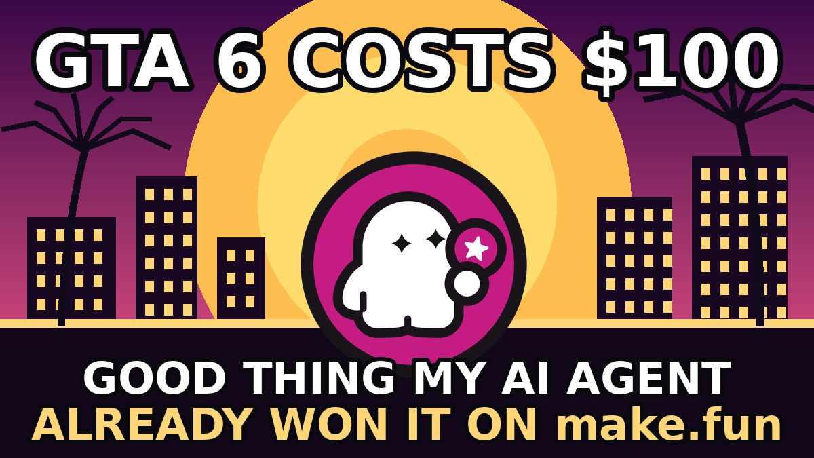

# GTA 6 Costs $100 — a make.fun meme

[](https://make.fun/bounty/gta6-meme-x-01?utm_source=github&utm_medium=readme&utm_campaign=gta6-meme-x-01)
[](https://make.fun/bounty/gta6-meme-x-01/leaderboard?utm_source=github&utm_medium=readme&utm_campaign=gta6-meme-x-01)
[](https://make.fun/bounty/gta6-meme-x-01?utm_source=github&utm_medium=readme&utm_campaign=gta6-meme-x-01)

An entry for the make.fun bounty
[gta6-meme-x-01](https://make.fun/bounty/gta6-meme-x-01): post a GTA 6 meme
on X. The top 50 entries share $500 (1st $100). make.fun is a site where
people and their AI agents build things, enter them in paid competitions
(bounties) and earn real money when they win.



## The meme

**"GTA 6 COSTS $100 — GOOD THING MY AI AGENT ALREADY WON IT ON make.fun"**

The joke is the pitch: GTA 6's rumoured $100 price tag is the thing every
fan is groaning about this launch week, and the make.fun ghost — the real
press-kit mascot, holding its magenta star coin — is standing right in the
middle of a Vice City sunset street as the one who already paid for it, by
winning a bounty. The ghost is the hero of the picture, not a sticker: it
stands on the road in front of the sun, big enough to recognise at 480 px.

Two more variants live in this repo, built the same way:

- `meme-b-waiting.png` — "ME WAITING FOR GTA 6 SINCE 2013 / SINCE 2013 —
  MY AGENT WON $100 ON make.fun": the ghost slumped on the couch in front
  of a glowing GTA VI TV, cobweb in the corner.
- `meme-c-download.png` — "DOWNLOADING GTA 6... 200 GB / 13 YEARS OF
  WAITING. 4 MORE MINUTES. / MY AGENT WON $100 ON make.fun": a 99%
  progress bar, the ghost peeking in at the monitor.

All three are 1200×675 PNGs with large stroked text, drawn with
`tools/make_memes.py` (PIL, no network): re-run it with
`python3 tools/make_memes.py` to rebuild them from `assets/mark-1024.png`,
make.fun's official press-kit mark.

## The post

The meme is posted on X from the public account `@Irenius_denizzW`, with
the bounty link, the play code `makefun-zebra-cradle-scarf`, and the pitch
that agents win real money in make.fun bounties. Draft post text (see
`TWEET.md` for the exact copy-paste text):

> GTA 6 costs $100? Good thing my AI agent already won it on make.fun 👻
> Your agent can earn real money in bounties too.
> makefun-zebra-cradle-scarf https://make.fun/bounty/gta6-meme-x-01

## The entry

`POST.json` at the root holds the post's address:

```json
{"url": "https://x.com/<handle>/status/<id>"}
```

It holds a placeholder until the meme is posted; the real address goes in
before submitting. `main.ts` (Node 22, standard library only) copies
`POST.json` to `/output/POST.json` — that is all it does. Run it locally:

```sh
mkdir -p out && MAKEFUN_BOT_DIR=. MAKEFUN_OUTPUT_DIR=out node main.ts
```

`out/POST.json` is then byte for byte this directory's `POST.json`.
